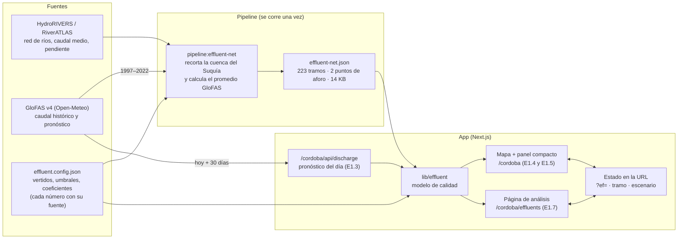
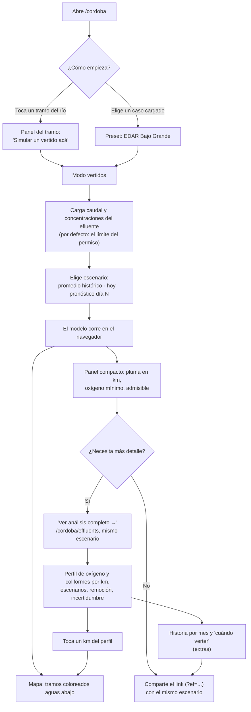
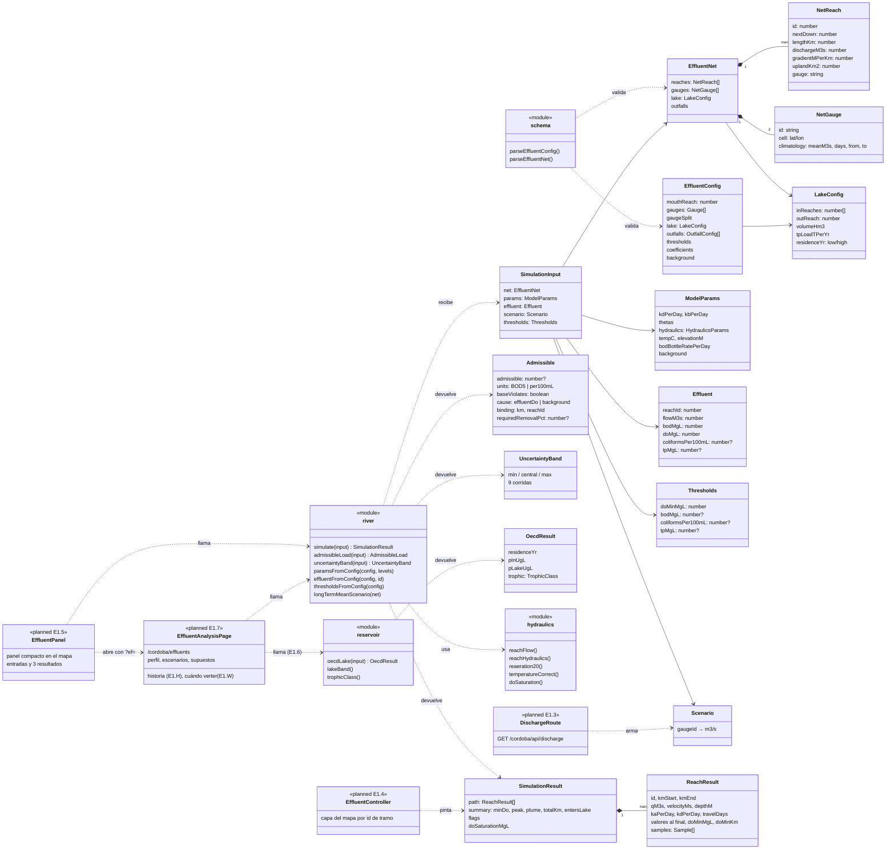

# Vertidos en la cuenca del Suquía: resumen del proyecto

> Documento para el equipo y para preparar el pitch de **Hack to the Future** (Córdoba Cluster, 12 y 13 de noviembre
> de 2026). Lo técnico en detalle está en [e1-effluents.md](../e1-effluents.md) y en
> [DECISSIONS.md](../../DECISSIONS.md#phase-e1-effluent-impact-2026-10-29).
> Versión sin tecnicismos: [explicacion-simple.md](explicacion-simple.md).
> Estado al 30/10/2026: modelo y datos listos (E1.0–E1.2); falta la interfaz, que ahora se reparte entre el mapa y una
> página de análisis aparte.

## En una frase

Una herramienta que, dado un punto de vertido y el caudal del río **hoy o en los próximos días**, muestra en el mapa
**hasta dónde llega la contaminación**, y en una página de análisis **cuánta carga puede recibir el río**, **cuánto
habría que tratar el efluente** y **qué días conviene verter**.

## El problema

- En Córdoba los permisos de vertido fijan **concentraciones** (por ejemplo, DBO₅ ≤ 40 mg/L según el Decreto 847/16).
  No miran cuánto caudal trae el río ese día.
- Pero el río no es siempre el mismo: con caudal medio diluye y se recupera; en estiaje, el mismo vertido puede dejar
  kilómetros de río sin oxígeno.
- El caso más conocido es el de la planta de **Bajo Grande**, que vierte al Suquía aguas abajo de la ciudad. El otro
  es la carga de **fósforo** que llega al **Embalse San Roque** por el Cosquín y el San Antonio, que alimenta las
  cianobacterias.

## Para quién es

Para el **regulador**: APRHI o un municipio. La pregunta que le resolvemos es _"con el caudal de hoy y el que viene,
¿este vertido está bien o no, y qué le pido a la planta?"_.

## Dos vistas: el mapa y la página de análisis

El mapa ya tiene paneles flotantes a los dos lados, y una serie de tiempo o un percentil no tienen nada de geográfico.
Por eso la interfaz se divide en dos:

| Vista                                    | Qué tiene                                                                                                                                                                                       |
| ---------------------------------------- | ----------------------------------------------------------------------------------------------------------------------------------------------------------------------------------------------- |
| **Mapa** (`/cordoba`)                    | La pluma pintada sobre el río, el punto de vertido, la leyenda y un panel chico: entradas y tres números (largo de la pluma, oxígeno mínimo, carga admisible). Botón "Ver análisis completo →". |
| **Análisis** (`/cordoba/effluents`)      | Perfil de oxígeno y coliformes por km, escenarios lado a lado, historia por mes, "cuándo verter", San Roque y todos los supuestos, períodos y fuentes.                                          |

### El simulador de vertidos

- **Desde dónde:** cualquier tramo de la cuenca del Suquía (los 223 tramos de la red), tocándolo en el mapa, o un
  vertido cargado (Bajo Grande). Fuera de esa cuenca no aparece la opción. Si el vertido está aguas arriba del San
  Roque, el modelo de río se corta en el lago y lo avisa.
- **Ajustes básicos, en el panel del mapa:** caudal del efluente, DBO₅, coliformes, oxígeno del efluente, % de
  remoción y escenario de caudal. Arranca con los valores del permiso y tiene un botón para volver a ellos.
- **Ajustes avanzados, en la página de análisis** (sección "Ajustes del modelo", cerrada por defecto): umbrales de
  oxígeno y coliformes, temperatura del agua y el nivel de cada coeficiente (bajo, central o alto, siempre dentro del
  rango de su fuente).
- Todo queda en la URL: el mapa y la página de análisis muestran la misma corrida y el link la reproduce.

Las dos vistas comparten el escenario por la URL (`?ef=...`): el botón abre la página de análisis con el mismo vertido,
caudal y escenario, y al tocar un km del perfil se vuelve al mapa en ese tramo. El link se puede compartir y sobrevive
a una recarga. Los gráficos se cargan solo en la página de análisis, así que el mapa no se pone más pesado.

## Qué responde

| Pregunta                     | Qué muestra la app                                                       | Dónde              |
| ---------------------------- | ------------------------------------------------------------------------ | ------------------ |
| ¿Hasta dónde llega?          | Largo de la "pluma" en km por encima del umbral, coloreada en el mapa    | Mapa               |
| ¿Cuánto oxígeno queda?       | Oxígeno disuelto mínimo y en qué km; en análisis, la curva completa      | Mapa y análisis    |
| ¿Cuánto aguanta el río?      | Concentración admisible del efluente para ese caudal                     | Mapa y análisis    |
| ¿Qué hay que hacer?          | Porcentaje de remoción necesario                                         | Análisis           |
| ¿Qué tan seguros estamos?    | Una banda de incertidumbre (9 combinaciones de coeficientes)             | Análisis           |
| ¿Cambia con el caudal?       | Caudal medio, hoy y pronóstico, lado a lado                              | Análisis           |
| ¿Cómo fue en el pasado?      | Por mes, % de días con oxígeno bajo el umbral (extra, E1.H)              | Análisis           |
| ¿Cuándo conviene verter?     | Carga admisible por día del pronóstico, con su banda (extra, E1.W)       | Análisis           |
| ¿Y el lago?                  | Fósforo esperado en San Roque y su estado trófico (extra, E1.6)          | Análisis           |

## Cómo funciona, sin vueltas

1. **Caudal.** Tomamos el pronóstico de caudal de **GloFAS** (servicio europeo Copernicus, vía Open‑Meteo) en dos
   puntos: Centro Cívico (Suquía) y la entrada al San Roque. Lo comparamos con el promedio histórico de ese mismo punto
   y aplicamos esa proporción a cada tramo del río. Si hoy el Suquía trae la mitad de lo normal, cada tramo también.
2. **Mezcla.** En el punto de vertido, el efluente se mezcla con el río según los caudales de ambos.
3. **Viaje aguas abajo.** Recorremos la red de ríos tramo por tramo (223 tramos en la cuenca del Suquía). En cada uno
   calculamos velocidad y profundidad con la pendiente real del cauce (fórmula de Manning) y, con eso, cuánto tarda el
   agua en recorrerlo.
4. **Lo que pasa en el camino.**
   - La materia orgánica (DBO) se degrada y consume oxígeno.
   - El río recupera oxígeno del aire (reaireación).
   - El balance entre las dos cosas es el clásico modelo de **Streeter‑Phelps**.
   - Los coliformes mueren con el tiempo.
   - Cada afluente que entra diluye todo.
5. **Resultado.** Para cada tramo sabemos la concentración, y con eso el largo de la pluma, el mínimo de oxígeno y la
   carga admisible. La respuesta es lineal en la carga, así que el admisible sale directo, sin prueba y error.
6. **Cuándo verter (extra).** Como el admisible sale directo, se puede calcular para cada día del pronóstico y para
   cada día de la serie histórica de GloFAS (1997–2022). No es aprendizaje automático: es el mismo modelo corrido
   muchas veces.
7. **Embalse (extra).** San Roque se trata como un tanque bien mezclado con el modelo **OECD/Vollenweider** para el
   fósforo.

Todo el cálculo corre **en el navegador** y tarda milisegundos, así que al mover un control el mapa y los gráficos
cambian al instante.

## Flujo de datos

> Las imágenes se generan desde el código Mermaid de cada bloque desplegable. Si cambiás un diagrama, regenerá su SVG
> en `img/`.

Código Mermaid (para editar el diagrama)

## Flujo del usuario

Código Mermaid (para editar el diagrama)

## Diagrama de clases (módulo `lib/effluent`)

Lo que ya existe está en `lib/effluent/`. Los componentes marcados como `planned` son de E1.3–E1.7 y E1.W.

Código Mermaid (para editar el diagrama)

## Primeros resultados (Bajo Grande, efluente al límite del permiso)

| Escenario                       | Oxígeno mínimo                 | DBO₅ admisible                         | Remoción necesaria |
| ------------------------------- | ------------------------------ | -------------------------------------- | ------------------ |
| Caudal medio histórico          | 6,24 mg/L, justo en el vertido | 414 mg/L (banda 130–2.448)             | 0 %                |
| Muy seco (5 % del caudal medio) | 1,29 mg/L                      | no hay: el límite se rompe aun sin DBO | no calculable      |

Cómo leerlo:

- **Con caudal normal**, cumplir el permiso alcanza: el río se banca la carga.
- **En estiaje**, lo que rompe el umbral no es la DBO sino que el efluente llega **sin oxígeno**. El modelo lo dice
  ("causa: oxígeno del efluente") en lugar de pedir "sacá el 100 % de la DBO".
- Ese contraste es el corazón del pitch: **un permiso fijo no sirve igual todos los días**. La página de análisis lo
  muestra de un vistazo, con los escenarios lado a lado y, si llegamos, la carga admisible día por día.

## Supuestos y límites (lo que tenemos que decir de frente)

- Es un **modelo de cribado** (_screening_), no uno calibrado. Sirve para comparar escenarios y ordenar prioridades;
  no reemplaza un estudio de calidad de agua.
- Los coeficientes son **rangos de bibliografía** (Chapra 1997, Bowie et al. 1985), no medidos en el Suquía. Por eso
  mostramos siempre una banda.
- **GloFAS es un modelo global** de unos 5 km de grilla. Sirve como tendencia, no como aforo.
- Córdoba **no fija un mínimo de oxígeno** para ríos: usamos 5 mg/L como supuesto editable.
- No hay datos públicos del efluente de Bajo Grande: por defecto usamos el **límite del permiso** (escenario de
  cumplimiento) y suponemos que llega sin oxígeno.
- El modelo de río **no cruza el embalse**: San Roque va con su propio modelo anual.
- "Cuándo verter" sale del mismo modelo de cribado, no de aprendizaje automático, y hereda todos estos límites.
- No hay niveles en tiempo real: Omixom no tiene API pública. Las curvas altura‑caudal del informe de la UNC (Grosso
  Ribero, Olivieri y Viotti; BaRatinAGE, una sección por río) pueden entrar como nivel cargado a mano. La del Suquía
  es en Centro Cívico, el mismo punto donde leemos GloFAS. Las curvas están pensadas para crecidas: falta confirmar
  hasta dónde valen en estiaje. Detalle en [explicacion-simple.md](explicacion-simple.md#dónde-entra-el-informe-de-la-unc).

## Estado

- [x] **E1.0** Documentación, decisiones y fuentes
- [x] **E1.1** Datos: red del Suquía y promedios GloFAS (`pipeline:effluent-net`)
- [x] **E1.2** Modelo de calidad con tests, revisado
- [ ] **E1.3** Ruta de pronóstico de caudal
- [ ] **E1.4** Modo vertidos en el mapa
- [ ] **E1.5** Panel compacto en el mapa (español e inglés)
- [ ] **E1.7** Página de análisis `/cordoba/effluents`: perfil, escenarios y supuestos (español e inglés)
- [ ] Extras: historia por mes (E1.H), "cuándo verter" (E1.W), San Roque (E1.6), curvas de la UNC (E1.R), partículas
      de flujo coloreadas (E1.F)

El MVP es E1.0–E1.5 más E1.7, con objetivo el 8/11. Rama `phase-e1-effluents`, subida a GitHub, sin PR todavía.

## Pendientes del equipo (antes de mostrarlo)

1. **Límites normativos**: leer en el navegador el límite de coliformes del Decreto 847/16 (Anexo I) y los valores de
   fósforo y amonio de la Res. APRHI 3/2025. Los PDF oficiales no se dejan leer por scripts.
2. **Punto de vertido de Bajo Grande**: ubicarlo en imagen satelital y confirmar el tramo 61477479.
3. **Permiso de los autores del informe de la UNC** para citar y usar sus curvas.
4. **Inscripción** al hackatón antes del 31/10 y revisar las instrucciones del 2/11.

## Después del hackatón (hoja de ruta)

En el orden en que suma valor:

1. Corregir el sesgo de GloFAS con aforos locales y las curvas de la UNC.
2. Calibrar los coeficientes cuando haya datos de monitoreo (INA‑CIRSA, CEQUIMAP).
3. Recién ahí, aprendizaje automático: una política de "cuándo y cuánto verter" (almacenamiento y descarga
   programada) optimizada sobre corridas históricas y de pronóstico. Va en la misma página de análisis, sobre lo que
   ya muestra E1.W.

Sin datos de monitoreo, un modelo de ML solo aprendería de vuelta nuestro propio modelo. Por eso queda para después.
